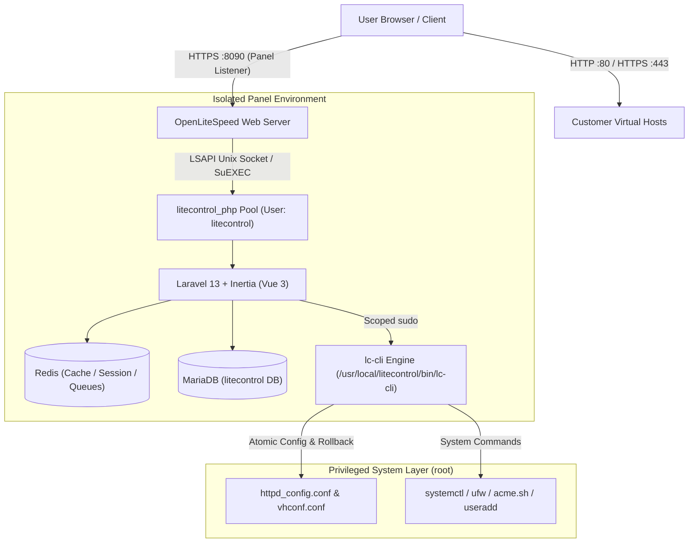

# LiteControl 🚀

[](https://ubuntu.com/)
[](https://github.com/)
[](https://openlitespeed.org/)
[](https://laravel.com/)
[](tests/bash)
[](panel/tests)
[](https://github.com/i1yaz/LiteControl)
[](LICENSE)

> [!WARNING]
> **EXPERIMENTAL & NON-PRODUCTION NOTICE**
> LiteControl is currently in an **active experimental development phase** and is **NOT intended or recommended for mission-critical production environments**. Features, architecture, configurations, and CLI interfaces may undergo breaking changes. Use on staging, test, or development VPS instances only.

**LiteControl** is an open-source, modular web hosting control panel engineered specifically for **Ubuntu LTS** servers. Powered by **OpenLiteSpeed (OLS)**, **MariaDB**, and an isolated **Laravel 13 + Inertia.js (Vue 3)** management stack, LiteControl delivers blazingly fast HTTP/3 & QUIC performance with a low memory footprint (~180 MB base RAM).

Designed from the ground up with a **lean-core philosophy**, heavy optional services (Pure-FTPd, PowerDNS, Postfix/Dovecot Mail, CSF, ModSecurity OWASP CRS, and ImunifyAV) are strictly on-demand—keeping your server fast, clean, and unencumbered.

---

## 📑 Table of Contents

- [Key Features](#-key-features)
- [Architecture & Security Model](#-architecture--security-model)
- [System Requirements](#-system-requirements)
- [Quick Start Installation (Ubuntu)](#-quick-start-installation-ubuntu)
  - [One-Line Automated Installer](#one-line-automated-installer)
  - [Manual Git Installation](#manual-git-installation)
  - [Custom Installation Flags](#custom-installation-flags)
- [Post-Installation & Access](#-post-installation--access)
  - [Accessing the Web Panel](#accessing-the-web-panel)
  - [Accessing phpMyAdmin](#accessing-phpmyadmin)
  - [Stored Secrets & Passwords](#stored-secrets--passwords)
- [CLI Management (`lc-cli`)](#-cli-management-lc-cli)
- [MultiPHP & Domain Management](#-multiphp--domain-management)
- [Security & Firewalls](#-security--firewalls)
- [On-Demand Optional Modules](#-on-demand-optional-modules)
- [Directory Hierarchy](#-directory-hierarchy)
- [Troubleshooting & Maintenance](#-troubleshooting--maintenance)
- [Development & Automated Testing](#-development--automated-testing)
- [License](#-license)

---

## ⚡ Key Features

- **OpenLiteSpeed Core**: Native support for HTTP/3, QUIC, Brotli, GZIP, and LiteSpeed Cache (LSCache) for WordPress and web apps.
- **Dual-Persona Modern UI**:
  - **Administrator (WHM-style)**: Server resource meters, service monitor, package management, user accounts, system configuration, security center, and on-demand modules.
  - **Hosting Customer (cPanel-style)**: Domain management, per-domain PHP version switcher, MySQL databases, web file manager, Let's Encrypt SSL, and backup downloads.
- **MultiPHP Engine (LSPHP 7.4 – 8.4)**: Run multiple PHP versions simultaneously. Switch PHP versions per virtual host in one click, tune `php.ini` directives graphically, and install PECL/PHP extensions on demand.
- **Strict Privilege Separation**:
  - The web UI runs as an unprivileged system user (`litecontrol:litecontrol`).
  - System operations run through `/usr/local/litecontrol/bin/lc-cli` via scoped, passwordless `sudo`.
  - Customer web roots run under isolated SuEXEC system accounts.
- **Atomic OpenLiteSpeed Configuration**:
  - Automated `.last_good` backup snapshot before any configuration change.
  - Syntax verification via `lshttpd -t`.
  - Automatic rollback on configuration failure to guarantee zero downtime.
- **Automated SSL Certificates**: Free Let's Encrypt SSL generation and auto-renewal via `acme.sh` (HTTP-01 challenge) and custom certificate upload for domains and panel port.
- **Web File Manager**: Responsive in-browser file manager with Monaco code editor, zip/unzip, drag-and-drop uploads, and strict path-traversal chroot jail.
- **Firewall & Security**:
  - Dual firewall engine: Native Ubuntu **UFW** or **ConfigServer Firewall (CSF)**.
  - OLS **ModSecurity** module with automated OWASP Core Rule Set (CRS).
  - **ImunifyAV** free malware scanner integration.
  - Dynamic panel port changer and SSH port hardening.
  - Time-based One-Time Password (TOTP) Two-Factor Authentication.
- **Backup & Restore**: Native tarball archiving of document roots and MariaDB databases with automated crontab scheduling and one-click restores.

---

## 🏗 Architecture & Security Model



### Core Stack vs Optional Modules

| Component | Default Status | Description |
| :--- | :--- | :--- |
| **OpenLiteSpeed** | **Core (Mandatory)** | High-performance event-driven web server with HTTP/3 & QUIC |
| **MariaDB Server** | **Core (Mandatory)** | Production database server hardened with socket authentication |
| **Redis Server** | **Core (Mandatory)** | In-memory store for panel caching, session handling, and background queues |
| **Primary LSPHP** | **Core (Mandatory)** | Default `lsphp83` with standard hosting extensions and Composer |
| **phpMyAdmin** | **Core (Mandatory)** | Database administration served securely under `https://<ip>:8090/phpmyadmin/` |
| **acme.sh & UFW** | **Core (Mandatory)** | Let's Encrypt SSL issuance and Uncomplicated Firewall |
| **Pure-FTPd** | *Optional Module* | Virtual FTP server with MariaDB authentication backend |
| **PowerDNS** | *Optional Module* | High-performance authoritative DNS server with MariaDB backend |
| **Mail Stack** | *Optional Module* | Complete email server (Postfix + Dovecot + OpenDKIM) |
| **CSF Firewall** | *Optional Module* | ConfigServer Security & Firewall with automated port synchronization |
| **ModSecurity** | *Optional Module* | Web Application Firewall with OWASP Core Rule Set |
| **ImunifyAV** | *Optional Module* | Linux server malware scanner and web shell detector |

---

## 💻 System Requirements

### Supported Operating Systems
- **Ubuntu 24.04 LTS** (*Noble Numbat*)
- **Ubuntu 22.04 LTS** (*Jammy Jellyfish*)
- **Ubuntu 20.04 LTS** (*Focal Fossa*)
- Architectures: **`x86_64` (amd64)** and **`aarch64` (ARM64)**

### Minimum Hardware
- **Processor**: 1 vCPU (2.0 GHz+)
- **Memory (RAM)**: 1 GB (LiteControl automatically provisions a 2 GB swap file on systems with ≤ 2 GB RAM)
- **Disk Storage**: 10 GB SSD / NVMe
- **Network**: 1 Public IPv4 address (Static)
- **Clean Installation**: Must be installed on a freshly installed Ubuntu server without existing web panels (cPanel, Plesk, CyberPanel, etc.) or standalone Apache/Nginx web servers.

---

## 🚀 Quick Start Installation (Ubuntu)

### One-Line Automated Installer

Connect to your Ubuntu server via SSH as `root` (or run `sudo -i`), then execute:

```bash
sudo bash -c "$(curl -fsSL https://raw.githubusercontent.com/i1yaz/LiteControl/main/install.sh || wget -qO- https://raw.githubusercontent.com/i1yaz/LiteControl/main/install.sh)"
```

---

### Manual Git Installation

For full control over source code and custom flags:

```bash
# 1. Update package lists and install Git
sudo apt-get update && sudo apt-get install -y git curl

# 2. Clone the LiteControl repository
git clone https://github.com/i1yaz/LiteControl.git /usr/local/litecontrol-src
cd /usr/local/litecontrol-src

# 3. Ensure executable permissions
chmod +x install.sh bin/lc-cli scripts/ubuntu/core/*.sh scripts/ubuntu/commands/*.sh

# 4. Run the installer
sudo bash install.sh
```

---

### Custom Installation Flags

The installer supports multiple parameters to tailor the installation to your server environment:

```bash
# Install with a custom panel port (e.g. 8443 instead of 8090)
sudo bash install.sh --port 8443

# Install with a randomized panel port (2000-9999) for enhanced security
sudo bash install.sh --random-port

# Specify the default primary PHP version (74, 80, 81, 82, 83, 84)
sudo bash install.sh --php 84

# Install with specific optional modules pre-enabled
sudo bash install.sh --with-ftp --with-dns --with-modsec

# Install a full enterprise hosting stack with all optional modules
sudo bash install.sh --with-ftp --with-dns --with-mail --with-csf --with-modsec --with-imunifyav
```

#### Available CLI Installer Flags

| Flag | Parameter | Description |
| :--- | :--- | :--- |
| `--port` | `<1024-65535>` | Sets the custom HTTPS listener port for LiteControl (Default: `8090`) |
| `--random-port` | *none* | Generates a random panel port between `2000` and `9999` |
| `--php` | `<74\|80\|81\|82\|83\|84>` | Sets the primary default LSPHP version (Default: `83`) |
| `--with-ftp` | *none* | Installs Pure-FTPd virtual FTP server with MariaDB backend |
| `--with-dns` | *none* | Installs PowerDNS server with MariaDB backend |
| `--with-mail` | *none* | Installs Postfix MTA, Dovecot IMAP/POP3, and OpenDKIM |
| `--with-csf` | *none* | Installs ConfigServer Security & Firewall (replaces UFW) |
| `--with-modsec` | *none* | Enables OpenLiteSpeed ModSecurity with OWASP CRS |
| `--with-imunifyav`| *none* | Installs ImunifyAV Free malware scanner |
| `-h`, `--help` | *none* | Shows installer help and option summary |

---

## 🔑 Post-Installation & Access

Upon successful installation, the terminal prints a completion banner detailing your server endpoints and initial credentials:

```text
======================================================================
  LiteControl Core Installation Completed Successfully!
======================================================================

  Panel URL              : https://203.0.113.10:8090
  phpMyAdmin URL         : https://203.0.113.10:8090/phpmyadmin/
  Panel Username         : admin
  Panel Password         : aB3$xK9#mQ2!vL8p
  MariaDB Root Password  : 9f8a4e12c5b73d61
  OLS WebAdmin Password  : 3e8b2a1c7d6e5f4a
  Secrets Directory      : /etc/litecontrol/secrets
  Install Log            : /var/log/litecontrol/install.log
  CLI Management         : lc-cli status
======================================================================
```

### Accessing the Web Panel
1. Open your web browser and navigate to:
   ```text
   https://<your-server-ip>:8090
   ```
2. Accept the self-signed SSL certificate warning (you can replace this with a valid Let's Encrypt certificate inside **Security → Panel SSL**).
3. Log in using username `admin` and your generated admin password.

### Accessing phpMyAdmin
- Open: `https://<your-server-ip>:8090/phpmyadmin/`
- Authentication:
  - Root: Username `root` and MariaDB Root password.
  - Client: Database username and database password.

### Stored Secrets & Passwords

For maximum security, passwords are generated cryptographically and stored in restricted files (`chmod 600`, owned by `root:root`) in `/etc/litecontrol/secrets/`:

```bash
# View all stored credentials at any time
sudo lc-cli credentials
```

Or read the individual secret files directly:
- Panel Admin Password: `/etc/litecontrol/secrets/panel_admin_password`
- MariaDB Root Password: `/etc/litecontrol/secrets/mysql_root_password`
- MariaDB Panel User: `/etc/litecontrol/secrets/mysql_panel_password`
- OLS WebAdmin Password: `/etc/litecontrol/secrets/ols_admin_password`

---

## 🛠 CLI Management (`lc-cli`)

LiteControl includes a command-line engine located at `/usr/local/bin/lc-cli` for server management and automation.

### Core Commands

```bash
# Check version
lc-cli version

# Check status of core services and installed modules
lc-cli status

# Display administrative credentials
lc-cli credentials

# Test OpenLiteSpeed syntax and perform a safe reload (with auto-rollback)
lc-cli ols-reload
```

### User & Quota Management

```bash
# Add a new hosting user
lc-cli user add john password123 john@example.com --quota 5120

# Suspend / unsuspend a customer account
lc-cli user suspend john
lc-cli user unsuspend john

# Update account disk quota (in MB)
lc-cli user quota john 10240

# List all users
lc-cli user list

# Delete a user and associated data
lc-cli user delete john --purge-files
```

### Virtual Host & Domain Management

```bash
# Add a new domain/virtualhost for a user
lc-cli vhost add example.com john --php 83

# Switch domain PHP version
lc-cli vhost php-switch example.com 84

# List all configured virtual hosts
lc-cli vhost list

# Delete a domain
lc-cli vhost remove example.com
```

### MultiPHP Engine

```bash
# List installed and available PHP versions
lc-cli php list

# Install an additional PHP version (e.g. LSPHP 8.2)
lc-cli php install 82

# Read or modify php.ini directives
lc-cli php ini-get 83 memory_limit
lc-cli php ini-set 83 memory_limit 512M
lc-cli php ini-set 83 upload_max_filesize 128M

# Install / enable / disable PHP extensions
lc-cli php ext-list 83
lc-cli php ext-enable 83 imagick
lc-cli php ext-disable 83 xdebug
```

### Database Management

```bash
# List all MySQL databases
lc-cli db list

# Create a database
lc-cli db create-db john_wordpress

# Create a database user and grant privileges
lc-cli db create-user john_dbuser SecurePass!99
lc-cli db grant john_dbuser john_wordpress

# Change database user password
lc-cli db password john_dbuser NewSecurePass!11

# Drop a database
lc-cli db delete-db john_wordpress
```

### SSL Certificates

```bash
# Issue Let's Encrypt certificate for a domain
lc-cli ssl issue example.com admin@example.com

# Renew all active certificates
lc-cli ssl renew

# Apply custom SSL certificate files to a domain
lc-cli ssl custom example.com /path/to/cert.pem /path/to/key.pem

# Apply custom SSL certificate to the LiteControl Panel port
lc-cli ssl panel-ssl /path/to/panel-cert.pem /path/to/panel-key.pem
```

### Security & Firewall

```bash
# Check UFW firewall status
lc-cli security ufw-status

# Open / close ports
lc-cli security ufw-allow 8443/tcp
lc-cli security ufw-deny 23/tcp
lc-cli security ufw-delete 8443/tcp

# Change the LiteControl panel HTTPS port dynamically
lc-cli security panel-port 9090

# Change SSH port
lc-cli security ssh-port 2222
```

### Backup & Restore

```bash
# Create an immediate full account backup
lc-cli backup create john

# List available backups
lc-cli backup list john

# Restore a specific backup archive
lc-cli backup restore john /var/litecontrol/backups/john_20261107_120000.tar.gz

# Schedule automated backups in crontab (e.g. daily at 02:00 AM)
lc-cli backup schedule add john "0 2 * * *" 7
```

### JSON Mode Contract

All `lc-cli` commands support the `--json` flag, outputting RFC-compliant JSON for integration with APIs, webhooks, or automation pipelines:

```bash
lc-cli --json status
```

Output:
```json
{
  "status": "success",
  "message": "LiteControl status retrieved.",
  "data": {
    "version": "1.0.0",
    "panel_port": 8090,
    "services": {
      "openlitespeed": "active",
      "mariadb": "active",
      "redis": "active",
      "ufw": "active"
    },
    "modules": [
      "ftp",
      "modsecurity"
    ]
  }
}
```

---

## 🌐 MultiPHP & Domain Management

LiteControl utilizes OpenLiteSpeed's high-performance external processor pool (`LSAPI`) to serve PHP.

- **Supported Versions**: LSPHP 7.4, 8.0, 8.1, 8.2, 8.3, and 8.4.
- **Isolated User Pools**: Customer virtual hosts run under per-user SuEXEC external processors (`<domain>_php`). A security flaw or resource exhaustion in one customer site cannot compromise the panel or other sites.
- **Atomic Reload & Hot-Switching**: Switching a website from PHP 8.1 to PHP 8.3 takes less than 1 second and executes without dropping active HTTP connections.

---

## 🛡 Security & Firewalls

### Dual Firewall Architecture
- **UFW (Uncomplicated Firewall)**: Configured by default with strict incoming policies. Automatically maintains open ports for HTTP (`80`), HTTPS (`443`), SSH, and the Panel Port (`8090`).
- **CSF (ConfigServer Firewall)**: Can be activated on demand via `--with-csf` or through the UI under **Security → CSF Firewall**. When installed, LiteControl automatically synchronizes allowed TCP/UDP ports into `/etc/csf/csf.conf`.

### Web Application Firewall (ModSecurity + OWASP)
- Enable ModSecurity on demand via `lc-cli module install modsecurity` or **Security → ModSecurity**.
- Automatically configures OWASP Core Rule Set (CRS 3.x), blocking SQL injection, XSS, local file inclusion (LFI), and remote code execution exploits at the web server layer.

---

## 📦 On-Demand Optional Modules

To preserve RAM and disk I/O, heavy modules are inactive until requested. They can be installed at any time via the command line or from **Modules Manager** in the Web UI:

```bash
# List all modules and their installation status
lc-cli module list

# Install / remove modules on demand
lc-cli module install ftp
lc-cli module install dns
lc-cli module install mail
lc-cli module install csf
lc-cli module install modsecurity
lc-cli module install imunifyav

# Uninstall a module
lc-cli module remove ftp
```

### Module Specifications

- **FTP (`pure-ftpd`)**: Configured with MariaDB user tables, passive port range `40110:40210`, TLS encryption support, and chrooted customer roots.
- **DNS (`pdns`)**: PowerDNS Authoritative Server with MariaDB backend. Automatically safely disables systemd-resolved's stub listener on port `53` to prevent DNS binding conflicts.
- **Mail (`postfix + dovecot`)**: Postfix MTA, Dovecot IMAP/POP3 with Maildir storage under `/var/vmail` (UID 5000), and OpenDKIM for domain signature verification.
- **CSF (`csf`)**: Advanced Stateful Packet Inspection firewall with Login Failure Daemon (lfd) monitoring brute-force attempts.
- **ModSecurity (`modsecurity`)**: Native OpenLiteSpeed `mod_security` integration with OWASP Core Rules.
- **ImunifyAV (`imunifyav`)**: Integrated web-based malware and backdoor scanner.

---

## 📂 Directory Hierarchy

```text
/usr/local/litecontrol/             # LiteControl Installation Root
├── bin/
│   └── lc-cli                      # Primary CLI management engine
├── scripts/
│   └── ubuntu/
│       ├── core/                   # 01-system.sh through 08-panel-setup.sh
│       ├── commands/               # user.sh, vhost.sh, php.sh, db.sh, ssl.sh, etc.
│       ├── modules/                # ftp.sh, dns.sh, mail.sh, csf.sh, modsec.sh
│       └── lib/
│           └── common.sh           # Core library (logging, atomic reload, JSON)
├── templates/                      # OLS, vhost, phpMyAdmin, and systemd templates
└── panel/                          # Laravel 13 + Inertia (Vue 3) Web Application
    ├── app/                        # Controllers, Models, Services (LcCliService)
    ├── resources/js/Pages/         # Vue 3 Dashboard, WHM & cPanel pages
    └── routes/web.php

/etc/litecontrol/                   # Configuration & State Directory
├── port                            # Active Panel HTTPS port (default: 8090)
├── secrets/                        # Cryptographic secrets (chmod 600)
│   ├── panel_admin_password
│   ├── mysql_root_password
│   ├── mysql_panel_password
│   └── ols_admin_password
├── ssl/                            # Self-signed and Let's Encrypt certificates
└── modules/                        # Marker flags for installed modules (*.installed)

/usr/local/lsws/                    # OpenLiteSpeed Web Server Root
├── conf/httpd_config.conf          # Main OLS configuration (backed up before edits)
├── conf/vhosts/                    # VirtualHost configurations
└── logs/                           # Access and error logs

/home/<username>/                   # Customer Account Document Roots
└── <domain.com>/
    └── public_html/                # Web Root
```

---

## 🔧 Troubleshooting & Maintenance

### 1. Installation Logs
The full log of every step executed during installation is stored at:
```bash
tail -f /var/log/litecontrol/install.log
```

### 2. Checking Service Status
If a service fails to start, verify its status:
```bash
# Check all LiteControl services at once
lc-cli status

# Or check individual system services
systemctl status lsws
systemctl status mariadb
systemctl status redis-server
systemctl status litecontrol-worker
```

### 3. OpenLiteSpeed Configuration Rollback
If manual edits to `/usr/local/lsws/conf/httpd_config.conf` cause OpenLiteSpeed to fail syntax checks, test and reload safely:
```bash
lc-cli ols-reload
```
`lc-cli` will automatically revert to the `.last_good` snapshot if the configuration contains errors.

### 4. Resetting the Panel Admin Password
If you lose or need to rotate the panel administrator password:
```bash
# 1. Generate a new password and update secret
NEW_PASS=$(openssl rand -base64 16 | tr -dc 'a-zA-Z0-9' | head -c 16)
echo -n "${NEW_PASS}" > /etc/litecontrol/secrets/panel_admin_password

# 2. Update the password in the database
cd /usr/local/litecontrol/panel
php artisan tinker --execute="\App\Models\User::where('username', 'admin')->update(['password' => \Illuminate\Support\Facades\Hash::make('${NEW_PASS}')]);"

echo "New admin password: ${NEW_PASS}"
```

### 5. Accessing OpenLiteSpeed WebAdmin
OpenLiteSpeed provides an internal console at `https://<server-ip>:7080`.
- Username: `admin`
- Password: Run `sudo lc-cli credentials` to retrieve the stored OLS admin password.

---

## 🧪 Development & Automated Testing

LiteControl contains comprehensive end-to-end unit and feature test suites covering all system layers.

### Running Bash Unit Tests (Phases 1–3)
Tests verify LF line endings, Bash syntax (`bash -n`), JSON serialization, atomic rollback, user quotas, vhost block generation, MultiPHP INI updating, and module lifecycles in an isolated mock sandbox:

```bash
# From repository root
bash tests/bash/run_tests.sh
```

### Running Laravel Feature Tests (Phases 4–6)
Tests verify authentication, role middleware, admin impersonation, package enforcement, path traversal defenses, OLS tuning updates, service control, and module management:

```bash
cd panel
php artisan test
```

### Building Frontend Assets (Vue 3 + Tailwind)
```bash
cd panel
npm install
npm run build
```

---

## 📄 License

LiteControl is open-source software licensed under the [MIT License](LICENSE).
Feel free to use, modify, and distribute it for personal and commercial hosting environments.

